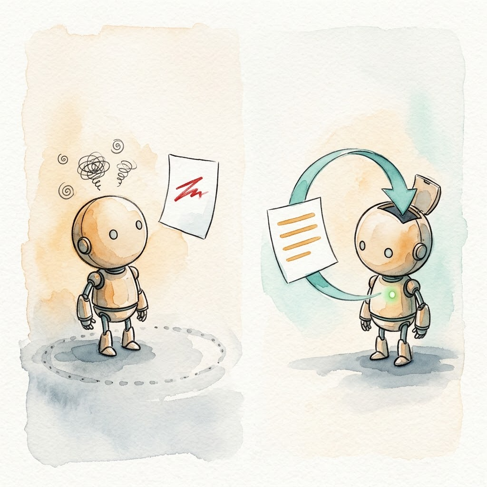

> Previous article: [Day 5 | Tools as Interface: Built-in, Extensions, Services](/en/posts/2026/10/ai-path-l3-day5-tools-as-interface/). Now that you know the three kinds of tools and how to pick a layer, this exercise walks you through installing a new tool with your own hands.

This is an L3 exercise article. Navigation for subsequent articles:

| Day | Type | Topic |
|-----|------|-------|
| Day 7 | Backbone | Meta-Architecture: Everything is a Plugin |
| Day 8 | Backbone | Memory, Traces, and Observability |
| Day 9 | Exercise | Graduation Project: Build a Team-Level CI/CD Automation Harness |
| Day 10 | Phase Summary | L3 Graduation Assessment + Harness Future Trends |

---

## The Third Time You Repeat It, Make It a Tool

Think about your daily routine for a second. In your agent sessions, do you keep piecing together the same bash command? Checking logs, searching rules, exporting data. Every time, the agent has to guess the parameters all over again and hit the same pitfalls.

My rule of thumb: **the third time you repeat a manual operation, that is the signal to turn it into a tool.**

My own trigger was rule search. Aristotle's rules library lives in Markdown files with frontmatter headers, and in the early days I had the agent piece together a custom grep command every time: `grep` for the keyword, `head` for the file header, `awk` for the fields. The composition wasn't hard, but by the third repetition I was annoyed. Every time, the agent assembled the command differently, the output format came out different, and occasionally it swallowed a few KB of irrelevant body text.

So the `list_rules` tool was born: one call, metadata only. Day 5 covered the redesigned two-pass query structure; today we walk through the whole birth process.

## Before You Build: Three Questions

Not every repeated operation deserves a tool. Before you build, run Day 5's three-question check:

1. **Can you compose it cheaply from existing tools?** If yes, don't build a new tool. Write it into AGENTS.md as a contract, or teach the agent to compose it via bash.
2. **Shared across the team, reusable across products?** Put it on the service layer. Write an MCP Server.
3. **High-frequency calls, performance-sensitive, needs session state?** Put it on the extension layer.

A finer-grained test comes from Pi's reason for shipping a built-in grep[1]: whether a feature deserves tool status depends on how much effort it costs the model, not on whether the model can do it at all. Raw grep output is unfriendly to models; structured match results eliminate format ambiguity and cut token consumption. That alone justifies built-in status.

My rule search fell between the criteria in questions 1 and 2. The grep composition had to be re-guessed every time, so it wasn't cheap. But the library is mine alone, with no cross-product sharing for now. Either path works. Following Day 5's advice, **start on the service layer**: write the MCP Server first, sink deeper only when needed.

## Step 1: Write an RCTFC Task Description

Before writing any code, turn "what I want it to do" into a verifiable description. L2 Part 5 introduced the RCTFC framework[2]; here it applies directly:

```
Role: You are a tool designer who writes clear interfaces for AI agents.

Context: The rules library currently holds roughly 30 active rules,
spread across Markdown files with frontmatter headers (name, tags, score).

Task: Implement a list_rules tool that searches the rules library by keyword.

Format: One rule per line: name | tags | match score. Metadata only, no body text.

Constraints: When nothing matches or the index is missing, return an actionable hint for the agent.
Never throw an exception that breaks the agent session.
```

Note the last constraint. It is a setup for Step 3.

This description sheet has two uses: it is the spec while you write code, and the measuring stick when you verify. Whatever you write into the description and however you wrap errors, it all has to trace back to these five lines.

## Step 2: Get a Minimal MCP Server Running, Then Spend Half Your Time on the Description

A minimal skeleton with the MCP Python SDK[3]:

```python
# server.py
from mcp.server.fastmcp import FastMCP

mcp = FastMCP("rules-search")


@mcp.tool()
def list_rules(keyword: str, limit: int = 10) -> str:
    """Search the rules library by keyword and return matching rules' names, tags, and match scores.

    Use for the coarse filtering pass: results contain metadata only, no rule body text.
    After picking candidates, use the read tool to load specific rule files on demand.
    """
    rules = load_rules_index()  # stream-scan frontmatter headers only
    kw = keyword.lower()
    matches = [r for r in rules if kw in r["name"].lower() or kw in r["tags"].lower()]
    return "\n".join(
        f"{r['name']} | {r['tags']} | score={r['score']}"
        for r in matches[:limit]
    ) or "No matching rules. Hint: try a shorter keyword."


if __name__ == "__main__":
    mcp.run()
```

The skeleton takes ten minutes. The real exercise today is not the skeleton. It is that docstring.

[Day 5](/en/posts/2026/10/ai-path-l3-day5-tools-as-interface/) made a bold claim: the description is the agent's entire understanding of a tool, and that field deserves roughly half your development time. Today you get to test whether that is an exaggeration. Write two versions of the description and run the same task three times with each:

Bad, one-liner: `"""Search rules."""`
Good, scenario version: the full docstring in the code above.

Watch the first call's parameters. Under the one-liner, the model often omits `limit` or treats the tool as full-text search, because nobody told it the tool is for coarse filtering. The two sentences "use for the coarse filtering pass" and "metadata only" in the good version make the decision for the model. Three samples is a small number, but the gap in first-call parameter accuracy is usually too wide to need a statistical test. Chapter 5 of `dg-ai-notes` has real cases of the same kind plus runnable examples for comparison[4].

## Step 3: Make It Fail on Purpose

Now pull the last constraint out of that Step 1 description sheet: "when nothing matches, return a hint; never throw."

Introduce a failure intentionally: move the rules index file away so the tool can't find it. First, the raw-error version:

```
Bad: INDEX_NOT_FOUND
```

Then the wrapped version:

```
Good: Rules index missing: ~/.aristotle/rules/index.json not found.
  Likely cause: the rules library was never initialized.
  Fix: run aristotle init first, or check that the rules directory path is configured correctly.
```

Compare the model's recovery path under these two error responses. Given the bare error code, the model stalls and guesses for a few rounds, or just declares defeat. Given the wrapped error, the next step is already written inside the error message itself. One round of recovery.

This is a hands-on replay of Day 1's `python: not found` finding. The loop's self-recovery ability rests entirely on error messages being clear enough. Two extra minutes writing error hints saves the model three or four rounds of wasted guessing, and every round costs real money in tokens.



## Step 4: Watch How Your Agent Discovers the New Tool

With the tool installed, don't rush to real work. Open a test session, give the agent a task that would use rule search, and watch three things:

1. **Where the tool shows up in context.** The schema is injected at startup, right next to AGENTS.md. The more tools you have, the bigger this fixed overhead. Day 5's "tool tax" becomes tangible here.
2. **Whether the first call's parameters are right.** This directly grades the description you wrote in Step 2.
3. **When it still picks `bash` over your new tool.** This observation carries the most information. If the model routes around your tool to hand-assemble `grep` in some scenario, don't blame the model first. It usually means the description doesn't cover that scenario. Go back and add one line about when to use it. That beats ten lines of "you must use it."

The observation notes themselves are field material for "tool design = agent UX." They don't need to be formal. Three lines are enough.

## Step 5: Installation Isn't Done Until It's Verified

The last step is the easiest to skip and the most important: prove the tool is actually installed and actually callable.

The bare minimum is two checks. The MCP Server's startup log prints the tool count (like Aristotle's MCP server printing "25 tools loaded" at boot). And a script makes one real call and asserts the return is non-empty. My own rule for the project: all five install paths come with a verification step. Whether installing via the curl one-liner or `install.sh`, every path has a documented check after it, guarded by 103 assertions in `test.sh`[5].

Verification becomes even more critical when multiple targets are involved. `tdd-pipeline` taught me this the hard way: its skill files have to sync across two deployment targets, the Claude Code skills directory and the OpenCode one. Miss one, and you get a subtle "same skill, different behavior" problem that takes an order of magnitude longer to debug than the install took[6]. This pit also reveals the service layer's second advantage. Write an MCP Server once and it works across Harnesses, with no dual-deployment drift by construction. In-process extensions buy you control at the price of portability. You only install to one target in this exercise, but you should know where this pit lives.

## Compare Before and After on the Same Task

All checks pass. Now run the comparison. Take the repeated operation you started with, run it three times each way, once with the bash composition and once with the new tool, and fill in this table:

| Metric | Bash composition | New tool |
|--------|------------------|----------|
| Steps to complete | | |
| Tool calls | | |
| Recovery rounds after an error | | |

Your own numbers go in the cells, and the result is the same experiment as Day 5's miniharness ablation data at a different scale. My own comparison: once `list_rules` returned metadata only, rule body text stopped entering the main session. The coarse filter streams the frontmatter scan, clocking under 20ms across all rule files. The main agent went from "swallowing thousands of tokens of body text per call" to "reading a shortlist." The savings were exactly those thousands of tokens of resident pollution Day 5 talked about.

## Optional Next Steps

Two paths. Walk one.

1. **Implement the same feature twice.** Rewrite `list_rules` as a Pi extension or an OpenCode custom tool[7], then compare it against the MCP version on communication overhead, control granularity, and portability. The point is to feel why "start on the service layer, sink deeper only when needed" is a one-way door: in-process code gets session state, which MCP can't give you, but you're bound to one Harness and have to rewrite for another. Pi's official extension examples live in the `pi-mono` repo[8].
2. **Run an evaluation-driven iteration.** Generate five evaluation tasks close to your real scenarios, hand the run records to an agent for analysis, and let it improve the description itself. This is the iteration loop from Anthropic's official tool design methodology; tools they iterated this way beat researcher hand-tuning on a held-out test set[9]. Afterwards, you'll look back at the Step 2 description polishing with a different feel.

## Today's Takeaways

Today we walked through one new tool from signal to verification:

1. **Signal.** The third repetition of a manual operation is your signal to convert it into a dedicated tool. The key criterion is how much effort the task costs the model, not whether the model can do it at all.
2. **Layer.** Start on the service layer with MCP; sink to the extension layer only when you need session state or zero overhead. That direction flows; backwards is painful.
3. **Description.** The agent's entire understanding of a tool lives in this field. Write two versions and A/B them on first-call parameter accuracy. The gap is usually obvious.
4. **Error wrapping.** Ship cause plus fix back to the loop, and it recovers in one round. Ship a bare error code, and the model guesses for three or four rounds. This is a hands-on replay of the Day 1 finding.
5. **Verification.** Installation isn't done until it's verified. Startup logs print tool counts; scripts make real calls and assert.

One line to remember: a description isn't a comment. It is the agent's entire understanding of the tool, and an install you can't verify is an install that didn't happen.

Day 7 returns to the backbone series. What happens to a Harness when the model, the session, and even other agents all become plugins? DeepSeek Harness's Cordis meta-architecture versus Pi's subtraction answer, head to head.

---

## References

1. [Pi official docs: tools.md (built-in grep and defaultTools configuration)](https://github.com/earendil-works/pi/blob/main/packages/coding-agent/docs/tools.md)
2. [Part 5: How Non-Coders Use AI to Write Code](/en/posts/2026/08/ai-path-l1-l2-part5/)
3. [MCP specification and quick start (Python SDK)](https://modelcontextprotocol.io/docs/getting-started/intro)
4. [buchidonggua/dg-ai-notes: pi_sdk_learn Chapter 5, "Defining Tools: From Feature Implementation to Interaction Design"](https://github.com/buchidonggua/dg-ai-notes/tree/main/pi-agent/pi_sdk_learn/docs)
5. [alexwwang/aristotle (MCP server and install verification scripts, see repo README)](https://github.com/alexwwang/aristotle)
6. [alexwwang/tdd-pipeline (the dual deployment targets lesson, see project docs)](https://github.com/alexwwang/tdd-pipeline)
7. [OpenCode official docs: Custom Tools](https://opencode.ai/docs/custom-tools/)
8. [badlogic/pi-mono: official Pi extension examples](https://github.com/badlogic/pi-mono)
9. [Anthropic: Writing effective tools for agents](https://www.anthropic.com/engineering/writing-tools-for-agents)
