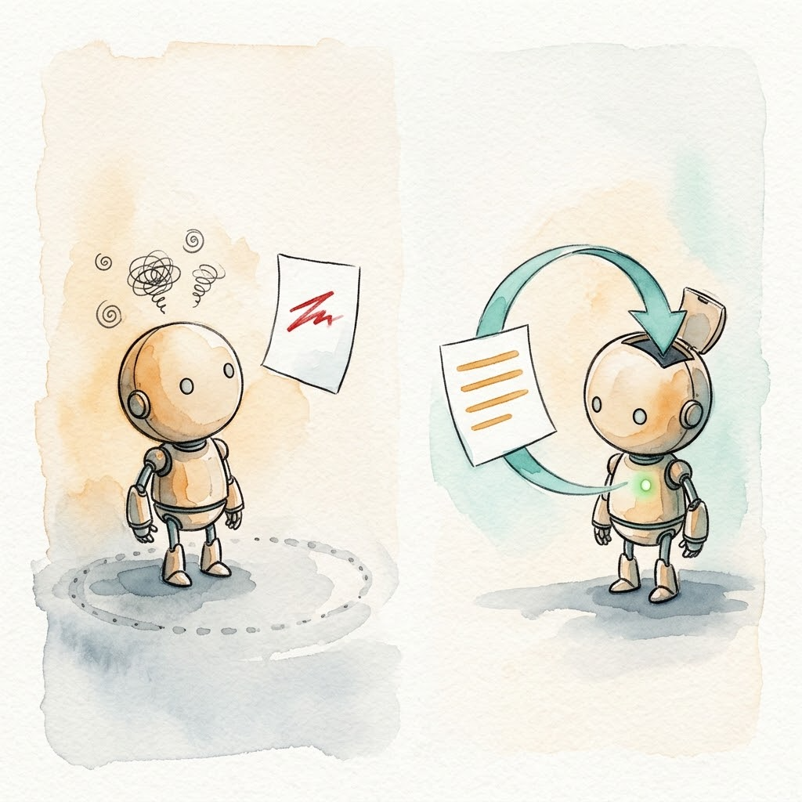

> 上一篇是 [Day 5｜工具即界面：内置、扩展、服务](/posts/2026/10/ai-path-l3-day5-tools-as-interface/)。讲清了工具的三种性质和落层判断后，本篇是练习篇——亲手装一个新工具。

本篇是 L3 的练习篇。后续导航：

| Day | 类型 | 主题 |
|-----|------|------|
| Day 7 | 骨干 | 元架构：Everything is a Plugin |
| Day 8 | 骨干 | 记忆、轨迹与可观测性 |
| Day 9 | 练习 | 毕业项目：搭建团队级 CI/CD 自动化 Harness |
| Day 10 | 阶段小结 | L3 毕业考核 + Harness 未来趋势 |

---

## 重复到第三次，就该做成工具了

先回忆一下你的日常：在 Agent 会话里，你是不是反复用 bash 拼同一条命令？查日志、搜规则、导出数据，每次 Agent 都要重新猜一遍参数，踩一遍同样的坑。

我的经验是：**一个手工操作重复到第三次，就是工具化的信号。**

我自己触发这个信号的场景是规则搜索。Aristotle 的规则库存在一个个带 frontmatter 的 Markdown 文件里，早期我每次都让 Agent 用 grep 手工组合：`grep` 找关键词、`head` 截文件头、`awk` 切字段。组合本身不难，但重复到第三次的时候我就烦了——每次 Agent 拼的命令都不一样，输出格式也不一样，偶尔还读进几 KB 无关正文。

于是 `list_rules` 工具诞生了：一次调用，只回元数据。Day 5 讲过它改造后的两轮查询结构，今天我们把整个出生过程走一遍。

## 动手之前：先过三问

不是每个重复操作都该做成工具。动手前，先过 Day 5 的对号入座三问：

1. **用现有工具能低成本组合出来吗？** 能，就别造。写进 AGENTS.md 让模型按流程做，或者教它用 bash 组合。
2. **团队共享、跨产品复用吗？** 是，放服务层，写 MCP Server。
3. **高频调用、性能敏感、需要会话状态吗？** 是，才放扩展层。

还有一个更细的判断标准，来自 Pi 内置 grep 的理由[1]：一个功能要不要做成工具，看模型做起来费不费劲就够了，做不做得到不是问题。裸 grep 的输出对模型不友好，结构化匹配结果能省模型一轮解析——这才值得内置。

我的规则搜索卡在第 1 问和第 2 问之间：grep 组合每次都要重新猜，不够"低成本"；规则库是我自己的，暂时没有跨产品共享的需求。两条路都通，按 Day 5 的建议**从服务层起步**，先写 MCP Server，有需要再下沉。

## 第一步：用 RCTFC 写一张任务描述纸

动手写代码前，先把"我要它做什么"写成可验收的描述。L2 Part 5 讲过 RCTFC 框架[2]，这里直接套用：

```
角色：你是一个工具设计师，擅长为 AI Agent 设计接口清晰的工具。

上下文：规则库目前有约 30 条生效规则，分散在带 frontmatter 的
Markdown 文件里，每条头部有 name、tags、score 字段。

任务：实现 list_rules 工具，按关键词搜索规则库。

格式：每行一条：规则名 | 标签 | 匹配分数。只回元数据，不含正文。

约束：无匹配或索引缺失时返回可操作的提示，不允许抛异常中断 Agent 会话。
```

注意最后一条约束，它是为第三步埋的伏笔。

这张描述纸有两个用途：写代码时它是规格，写完验收时它是标尺。 description 写什么、错误怎么封装，回头都要能对回这五条。

## 第二步：先跑通最小 MCP Server，然后花一半时间打磨 description

MCP Python SDK 的最小骨架[3]：

```python
# server.py
from mcp.server.fastmcp import FastMCP

mcp = FastMCP("rules-search")


@mcp.tool()
def list_rules(keyword: str, limit: int = 10) -> str:
    """按关键词搜索规则库，返回匹配规则的名称、标签和匹配分数。

    用于第一步粗筛：结果只含元数据，不含规则正文。
    拿到候选后，用 read 工具按需读取具体规则文件。
    """
    rules = load_rules_index()  # 流式扫描 frontmatter，只读文件头
    kw = keyword.lower()
    matches = [r for r in rules if kw in r["name"].lower() or kw in r["tags"].lower()]
    return "\n".join(
        f"{r['name']} | {r['tags']} | score={r['score']}"
        for r in matches[:limit]
    ) or "无匹配规则。提示：试试更短的关键词。"


if __name__ == "__main__":
    mcp.run()
```

骨架十分钟能写完，但今天真正的练习不在骨架，在那个 docstring 上。

[Day 5](/posts/2026/10/ai-path-l3-day5-tools-as-interface/)说过一句狠话：description 就是 Agent 对这个工具的全部认知，这个字段值得花一半的开发时间。今天验证它是不是夸张。写两版 description，各跑同一个任务三次：

❌ 一句话版：`"""搜索规则。"""`
✅ 场景版：上面代码里的完整 docstring。

观察第一次调用的参数：一句话版下，模型经常不传 `limit`，或者拿它当全文检索用——因为没人告诉它这工具是粗筛用的。场景版里"用于第一步粗筛""只含元数据"这两句，就是在替模型做决定。三次样本很少，但参数正确率的差距通常大到不需要统计检验。dg-ai-notes 第 5 章有同类的真实案例和可运行示例，可以对照[4]。

回头拆解这两版 description，差距集中在三处，这就是首写清单：

1. **干什么、什么场景用**：「用于第一步粗筛」一句，替模型决定了选不选这个工具。
2. **输出边界**：「只含元数据，不含正文」，模型据此规划拿到结果后的下一步。
3. **后续动作指引**：「拿到候选后，用 read 工具按需读取」，把工具嵌回工作流，免去"拿到元数据然后呢"的停顿。

一句话版恰好三条全缺：模型不知道它是粗筛，拿它当全文检索；不知道 `limit` 的含义，干脆不传；不知道结果之后该做什么。写 description 时按这三条逐项过一遍，再用上面的 A/B 实验验收。

## 第三步：故意让它失败一次

现在把第一步描述纸里的约束翻出来："无匹配时返回提示，不允许抛异常。"

故意制造一个失败：把规则库索引文件挪走，让工具读不到。先看裸错误的写法：

```
❌ 错误：INDEX_NOT_FOUND
```

再看封装后的写法：

```
✅ 错误：规则索引缺失，~/.aristotle/rules/index.json 不存在。
   可能原因：规则库未初始化。
   解决办法：先运行 aristotle init，或检查 rules 目录路径是否配置正确。
```

对比两种方式下模型的恢复路径：拿到裸错误码，模型会停在原地猜几轮，甚至直接宣布放弃；拿到封装后的错误，它下一步该做什么已经写在错误里了，一轮恢复。

这是 Day 1 那个 `python: not found` 实证的亲手复现：loop 的自我恢复能力，完全建立在错误信息足够明确的前提上。工具设计者多花两分钟写错误提示，省下模型三四轮无效试错，每轮都是真金白银的 token。



## 第四步：看 Agent 怎么发现新工具

装好工具后先别急着干正事，开一个测试会话，给 Agent 一个会用到规则搜索的任务，然后观察三个点：

1. **工具出现在上下文什么位置**：启动时 schema 就被注入系统层，和 AGENTS.md 是邻居。工具越多，这份固定开销越大——Day 5 的"工具税"在这里能看到实物。
2. **首次调用的参数是否正确**：这一步直接检验第二步 description 的成色。
3. **什么时候它仍然选 bash 而不是新工具**：这是最有信息量的观察。如果模型在某个场景绕开你的工具去拼 grep，别急着怪模型——这往往说明 description 没覆盖那个场景，回去补一句"什么情况该用它"比写十句"你必须用它"有效。

这份观察记录本身就是"工具 = Agent UX"的现场教材。你不需要写得很正式，三行笔记就够。

## 第五步：装完必须可验证

最后一步最容易被跳过，也最重要：证明工具真的装上了、真的能调通。

最低限度的自检两项：MCP Server 启动日志打印工具数（类似 Aristotle MCP server 启动时的 "25 tools loaded"），以及脚本里对工具做一次真实调用、断言返回非空。我给自己项目的规矩是五条安装路径每条都配验证步骤——curl 单行装完跑什么、install.sh 装完跑什么，全部写死在文档里，test.sh 里 103 条断言守着[5]。

为什么这么较真？因为 tdd-pipeline 给过我教训：它的 skill 文件要同步到 Claude Code 和 OpenCode 两个 skills 目录，漏了一个，就会出现"同一个技能两边行为不一致"的隐性问题，排查起来比装的时候麻烦一个数量级[6]。这个坑还点破了服务层的另一个价值：MCP Server 一次写好多家 Harness 通用，天然规避双部署漂移；进程内扩展换来的是控制力，付出的是可移植性。练习时你只装一个目标，但要知道这个坑在哪。

## 对比验证：扩展前后跑同一个任务

验收全部通过，最后跑一次对比。用你最初那个重复操作当任务，分别在"bash 手工组合"和"新工具"两种方式下各跑三次，记录这张表：

| 指标 | bash 组合 | 新工具 |
|------|-----------|--------|
| 完成步骤数 | | |
| 工具调用次数 | | |
| 出错后恢复轮数 | | |

第三项说明一下口径：执行中任何一步失败都算出错，命令报错、工具调用失败都算。恢复指 Agent 不需要人介入，自己读错误、修正，让任务回到正确轨道。恢复轮数就是从报错到回到轨道的 loop 轮数，一轮等于一次"看到错误输出、推理、发出下一个动作"。第三步那个实验用的就是这把尺：裸错误码三四轮，封装版一轮。

你自己的数字填进去，和 Day 5 引用的 miniharness 消融数据就是同一个实验的两种规模。我当时的对照结果是：`list_rules` 只回元数据后，规则正文不再进入主会话，粗筛靠流式 frontmatter 扫描，全部规则文件 20ms 内完成；主 Agent 从"每次吞几千 token 正文"变成"只看候选名单"，省下的就是 Day 5 说的那几千 token 常驻污染。

## 可选进阶

两条路，选一条走通：

1. **同一功能双实现**：用 Pi 扩展或 OpenCode 自定义工具[7]把 `list_rules` 再写一遍，和 MCP 版本对比通信开销、控制粒度、可移植性。重点体会"从服务层起步、有需要再下沉"为什么方向不可逆：进程内能拿到会话状态，这是 MCP 给不了的；但绑死单一 Harness，换产品要重写。Pi 官方扩展示例在 pi-mono 仓库[8]。
2. **跑一轮评估驱动迭代**：生成 5 个贴近你真实场景的评测任务，把运行记录交给 Agent 分析，让它自己改进 description。这是 Anthropic 官方工具设计方法论里的迭代循环，他们在内部用它迭代出的工具，在留出测试集上超过了研究员手工调优的版本[9]。做完你会对第二步的 description 打磨有新的手感。

## 今日收获

今天我们把一个新工具从信号到验收走完了全程：

1. **信号**：重复到第三次的手工操作，就是工具化的信号。判断标准只有一条：模型做起来费不费劲。
2. **落层**：默认从服务层起步写 MCP，需要会话状态或零开销再下沉扩展层——升级方向顺，反过来麻烦。
3. **description**：Agent 对工具的全部认知都在这个字段里。写两版做 A/B，看首次调用参数正确率，差距一目了然。
4. **错误封装**：原因加解决办法一起回灌，loop 一轮恢复；只丢错误码，模型原地猜三四轮。这是 Day 1 实证的亲手复现。
5. **自检**：装完必须可验证。启动日志打印工具数，脚本做真实调用断言。

记住一句话：**description 不是注释，是 Agent 对这个工具的全部认知；装完不能验证，等于没装。**

Day 7 回到骨干篇：如果模型、会话、甚至别的 Agent 都能插件化，Harness 会变成什么样子——DeepSeek Harness 的 Cordis 元架构和 Pi 的减法答案，正面对比。

---

## 参考资料

1. [Pi 官方文档：tools.md（内置 grep 与 defaultTools 配置）](https://github.com/earendil-works/pi/blob/main/packages/coding-agent/docs/tools.md)
2. [AI 之路进阶升级指南（五）：不懂编码的人怎么用 AI 写代码（RCTFC 框架）](/posts/2026/08/ai-path-l1-l2-part5/)
3. [MCP 规范与快速上手（Python SDK）](https://modelcontextprotocol.io/docs/getting-started/intro)
4. [buchidonggua/dg-ai-notes：pi_sdk_learn 第 5 章"定义工具——从功能实现到交互体验"](https://github.com/buchidonggua/dg-ai-notes/tree/main/pi-agent/pi_sdk_learn/docs)
5. [alexwwang/aristotle（MCP server 与安装验证脚本见仓库 README）](https://github.com/alexwwang/aristotle)
6. [alexwwang/tdd-pipeline（skill 文件双部署目标教训见项目文档）](https://github.com/alexwwang/tdd-pipeline)
7. [OpenCode 官方文档：Custom Tools](https://opencode.ai/docs/custom-tools/)
8. [Anthropic：Writing effective tools for agents](https://www.anthropic.com/engineering/writing-tools-for-agents)
9. [badlogic/pi-mono：Pi 官方扩展示例](https://github.com/badlogic/pi-mono)
