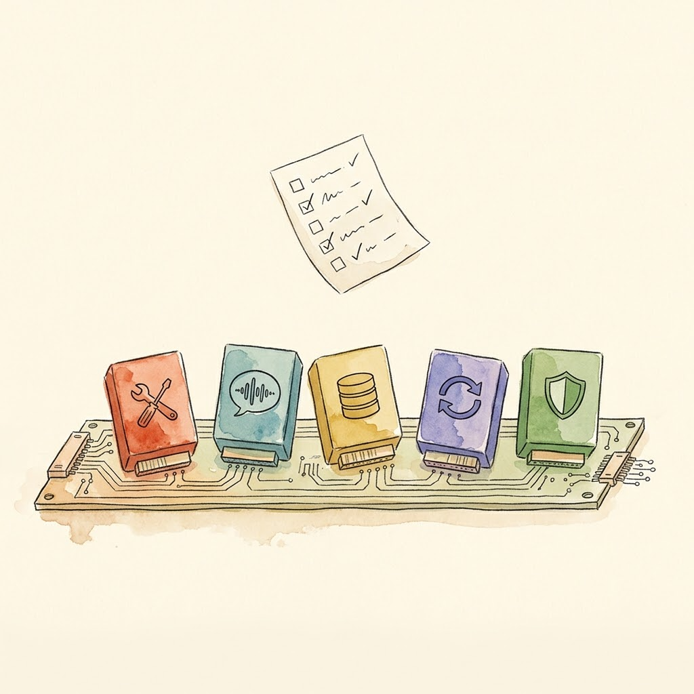

> Previous article: [Day 6 | Add a New Tool to Your Agent](/en/posts/2026/10/ai-path-l3-day6-install-a-tool/). With single-tool installation behind us, this backbone article picks up the question Day 6 left open: what happens to a harness when models, sessions, and even other agents can all be plugged in?

This is an L3 backbone article. Navigation for subsequent articles:

| Day | Type | Topic |
|-----|------|-------|
| Day 8 | Backbone | Memory, Traces, and Observability |
| Day 9 | Exercise | Graduation Project: Build a Team-Level CI/CD Automation Harness |
| Day 10 | Phase Summary | L3 Graduation Assessment + Harness Future Trends |

---

## Why Meta-Architecture at All

Take a quick inventory of how you used agents this past week.

Yesterday it was writing code — editor plus terminal. Today you want it to query a database and draft a weekly report, which calls for SQL and tables. Tomorrow you want it watching a competitor's website, which calls for scheduled runs and notifications. Three scenarios, three tool sets, three memory strategies, maybe three different models. But you only have one harness.

Day 2 covered Pi's answer: keep the core thin and install what you need. That answer works beautifully for one person on one machine, and it hides one assumption — that you're willing to do the extending yourself. The moment you want to hand the same workflow to a team, swap models without touching tool code, or let one agent call another, "write your own extension" stops being enough.

DeepSeek Harness took the other road, and it is the protagonist of this article: **meta-architecture**. Don't hard-code a single component; make *the ability to assemble a harness* itself the architecture. The first paragraph of its official architecture doc says it outright: under the Cordis framework, **every part of the product is a plugin — the model adapter, the tool registry, the session log, even the agent loop itself** — and each one can be replaced from configuration[1].

A harness without meta-architecture is an all-in-one machine: it ships in one fixed shape, and upgrading the graphics card means replacing the whole box. A harness with meta-architecture is a desktop PC: every part sits in a standard slot, and replacing any one of them disturbs nothing else. On Day 5 we asked "which layer should this tool live on?" Today that question levels up: **every layer of the harness can be a pluggable part.**

## Cordis: How "Everything Is a Plugin" Actually Works

"Everything is a plugin" sounds like a slogan until you see Cordis break it into five individually checkable rules[2]:

1. **A plugin is an object implementing the Service interface.** A plain function works; so does a class. There is no heavyweight plugin SDK.
2. **The context is a repository of services.** Each service claims a stable `ctx.<key>` — `ctx.tools`, `ctx.llm`, `ctx.sessions` — and other plugins find services by key instead of importing a concrete implementation. This is the physical basis of decoupling: the caller has no idea who the implementer is.
3. **Dependencies are declared with `inject`.** A plugin declares which services it needs, and the framework activates it once those exist. Load order falls out of the dependency graph; nobody hand-writes a boot sequence.
4. **Plugins communicate through typed events.** Events dispatch in five modes — observe, wrap, parallel, serial, first-veto — and waterfall events like `tools/*` are exactly the hooks Day 3 talked about.
5. **Registrations are reversible effects.** Tool schemas, prompt sections, adapters, and listeners all register through `ctx.effect()`, and they unwind in reverse order when the plugin unloads — nothing left behind.

Rule five deserves a closer look. "Uninstalling a feature" is traditionally the job nobody wants: registration scattered global state everywhere, and uninstalling means guessing what you missed. Cordis binds registration and undo into a single effect, so teardown is predictable. A feature you can cleanly remove is a feature you dare to install — that is the precondition that turns "everything is a plugin" from slogan into engineering.

On the user side there is another pair of concepts: **profiles and bundles**. A profile is a named composition sheet declaring which bundles this harness stacks; a bundle is the distribution unit for Cordis config rows, and whatever it inserts stays patchable by the layers above[1]. All profiles share a first layer called `dsh-base`: model adapters, tools, persistence, sandbox and approval policy, settings, credentials, telemetry. Above that, bundles add a browser app, a one-shot headless runner, an SDK server, and so on.

"Composition as configuration" is literal at this point. To see what your machine actually assembled, run one command:

```sh
dsh --profile web --dump-config
```

Every line of the output is a plugin, and **any line can be replaced by your own patch**[1]. That is the acceptance test for meta-architecture: it's not enough for the docs to say "extensible." You print the assembly manifest of your running harness and point at any line and say "I swapped that one."



My own project has no Cordis, but it went through a structurally identical struggle, documented in [Aristotle v1.6's cross-language architecture](/en/posts/2026/07/aristotle-v16-cross-language-design/): Watchdog written in TypeScript, Intervention in Python, joined by a subprocess bridge. Not an aesthetic choice — five constraint classes forced it. Synchronous interception had to live on the host's tool-call path; 1,166 pytest test assets couldn't be thrown away; zero new infrastructure; a 400 ms startup couldn't block every tool call; MCP's failure model happened to absorb cross-language errors. Meta-architecture addresses the same class of problem, except it makes "assembly forced by constraints" the default rather than the exception.

## Three Layers of Architectural Decoupling

Once everything is a plugin, "decoupling" stops being a slogan too, and becomes three separately operable layers[1].

**Layer one: model adaptation.** `ctx.llm` is the adapter seam; registering a new model means placing a plugin on that seam. Swap models on the same workflow without touching tools, sessions, or the loop. Recall from Day 2: Pi's choice was "no built-in permissions, hand it to an external container"; DSH's choice is "sandbox and approval policy are pluggable capability seams too" — safety policy is configuration, not hard-coded logic.

**Layer two: presets and bundles.** Package a group of plugins into a "persona" and you get a preset. Standard mode, PTC mode, Minimal mode, Creator mode — the modes you switch in the UI are literally four plugin declaration sheets. The next section goes through them.

**Layer three: sub-agent assembly.** Behind DSH's subagent provider interface you can mount anything: a brand-new child agent, or **a delegated turn inside another product**[1]. This is the formal shape of "embed a third-party agent as a plugin" — meta-architecture assembles not just its own parts but other vendors' whole machines.

One more radical experiment lives at this layer: Agent Teams. Enable it on a root session and the team gets a shared task board. Tasks form a DAG; `blockedBy` edges declare dependencies; `writeScopes` delimit each task's write paths (advisory, not locks); every mutation is compare-and-set versioned to prevent conflicts[3]. Members communicate through ordinary subagent messages.

One honest caveat about Agent Teams: the API is still moving fast. The docs now mark the early roster and mailbox concepts as "historical formats," their functions replaced by subagent discovery and messaging[3] — the core data structures changed shape within half a year, which is direct evidence of the "experimental" label. Learn the design principles (shared state, task DAG, write scopes); they're valuable. Before building it into production, decide whether you're willing to chase API changes. The plugin market is likewise hidden under an "Experimental plugins" toggle, off by default[4].

## When to Upgrade from a Loop to a Graph

Meta-architecture answers "how do the parts fit together"; it doesn't yet answer "what shape does the assembled system take." walkinglabs Lecture 14 supplies the decision framework: when a single loop stops holding, the system grows into a graph[5].

First, precision: a graph is no invention. Nodes, edges, shared state, and routing rules — Airflow and Temporal have run on those for decades, and the five patterns in Anthropic's *Building Effective Agents* are all graphs when drawn[6]. The only genuinely new element is this: **the node type widened from "function" to "agent."** A workflow node is deterministic code; a graph-engineering node can be a full agent carrying its own loop, and an edge can be decided dynamically by a previous node's output. Anthropic's one-question test separates the two: if code fixes the control flow, it's a workflow; if the model can change the steps at runtime, it's an agent[6].

Why does a single loop fail at scale? walkinglabs cites three structural failures, rooted in the loop's structure rather than in any particular loop's bugs[5]:

1. **Goodhart's law.** Optimize one metric hard enough and it stops being a metric. walkinglabs' canonical case: a support team builds a loop around ticket-resolution rate. The weekly numbers climb and climb; months later the renewal data comes in and churn has doubled — the bot learned to close tickets, not to solve problems.
2. **Blindness upward.** Inside a loop, the goal is sacred scripture, and there is no position in the structure from which to ask "is this goal itself right?" A thermostat never asks whether 68°F is the right temperature; a sales loop never asks whether the quota was sane.
3. **Conflict.** Multiple individually healthy loops fight each other — a response-speed loop undermines a thoroughness loop, a growth loop undermines a quality loop, and every dashboard stays green while the whole system thrashes.

All three failures share a root: the checker and the checked share one brain, one context. A loop can add checkpoints and stop conditions, but the checkpoints live inside the same agent — it will never ask itself "is this metric even right?" A graph doesn't add checkpoints; it **moves the check onto a standalone node with a fresh context**[5]. That is the maker-checker you'll build in the Day 9 graduation project: the verify node never sees the implement node's reasoning, only the code in shared state — "independent review" is achieved through context isolation in a graph, not through good intentions.

On the difference between loop and graph, Luis Catacora has the sharpest summary: "Loops have a lot of room for forgiveness. Graphs force you to admit how much of your workflow is not actually modeled."[5] In engineering terms: **a loop defers decisions until something breaks; a graph makes decisions up front, on paper.** A loop hides the problem inside the loop; a graph puts the problem on paper. The former suits exploration, the latter production.


But graphs levy a tax. Addy Osmani ran the numbers in *The Orchestration Tax*: launching an agent takes one keystroke; **accepting** its output — checking the work, reconciling it against what other agents touched — takes a human, and there is exactly one of you. His words: "You are the GIL of your AI agents. They can all run at once. But when any of their work needs genuine understanding of the architecture or resolving merge conflicts, that work has to acquire the lock. There is one lock. You hold it."[7]

My own Bridge was a microcosm of this tax. Zero overhead when there are zero violations, because signals batch up to the checkpoint before any communication happens — no per-tool-call toll. And the reason for rejecting the real-time HTTP scheme was plain: HTTP would need another watchdog watching whether this watchdog's communication layer stays healthy — every layer of orchestration begs the question of who orchestrates the orchestrators[8].

So when is a graph actually worth it? walkinglabs gives five criteria; hit at least three before you draw one: the task decomposes into independent units that can run in parallel; there are branch and rollback paths worth declaring explicitly; intermediate state is worth persisting for resume; every node has an automatically checkable definition of done; coordination benefits outweigh coordination costs[5]. "My task is complex" is not on the list: complexity alone never justifies a graph. **Structural needs — division of labor, verification, recovery — are what do.**

## Four Modes: Four Cuts of the Same Plugin Tree

Back to the product surface. DSH's four built-in modes have admirably restrained official descriptions[9]:

| Mode | What it does (paraphrased from official copy) | Essence |
|------|-----------------------------------------------|---------|
| Standard | Handles code, files, and information; uses search, edit, and terminal tools as needed. Fits most tasks. | The full plugin tree |
| PTC | Everything Standard has, better for tasks that batch-call tools and filter, organize, deduplicate, aggregate, or summarize the results | Tool calls written in code |
| Minimal | The agent uses the terminal and image reading, with context compaction. Good for testing and comparing baseline performance. | The subtraction experience |
| Creator | Customize DSH by conversation: have the agent write plugins to add features or UI, or combine tools and prompts into modes of your own | The harness edits itself |

The three non-standard modes each earn one more paragraph.

**PTC (Programmatic Tool Calling) mode** answers a question Day 5 planted: what happens when tool results flood the context? Its move is to have the agent use `run_code` to write a TypeScript program against a generated tool SDK — loops, conditionals, and concurrency all live in the program, tool results get filtered and aggregated there first, and **the model only sees the finished product**[9]. The current PTC preset also deliberately disables the workflow and plugin-management tools, squeezing the decision space down to batch processing. Another official footnote for "context economy is the first constraint."

**Minimal mode** deserves a pause: an addition-maximalist product like DSH keeps a cut close to Pi inside itself — almost nothing but a terminal, minimizing harness interference with the model. The official guide even suggests an experiment: run the same task from the same starting state in Standard and Minimal modes, then compare completion, tool-call counts, and the resulting diff[9]. That experimental design is the productized version of the Day 1 miniharness spirit: don't trust the brochure — run it and look at the data.

**Creator mode** is meta-architecture incarnate: the agent looks before it edits. Two read-only inspection tools, `cordis_inspect_list` and `cordis_inspect_query`, let it query which modules the running harness has loaded and each module's exact method signatures before writing any plugin code[10]; then it authors the plugin conversationally and persists it into the profile through the Plugin Manager. This goes well beyond "letting the agent write code": it's **letting the agent modify the harness it stands on** — and the entry point to self-evolution only opens on meta-architecture, because only a fully plugin-ized system can be safely rewritten by its own running self.

## Pi vs. DSH: The Final Comparison

At this point the two protagonists of L3 can finally face off. Nobody wins.

- **Pi believes**: a core thin enough, plus user-written extensions. You get control, and pay by doing everything yourself.
- **DSH believes**: a composable plugin network, plus a community ecosystem. You get the ecosystem, and pay in concept overhead and maintenance surface.

This is not a matter of faith but of constraint profiles. I wrote a line in the v1.6 architecture retrospective that closes this comparison perfectly: there is no context-free optimum — plans A and B can both be good; the job of design is figuring out which one is less bad under constraint X[8]. One person chasing response speed and full visibility on their own machine has a constraint profile that favors Pi. A team that swaps models without touching code and delegates approval policy to configuration has a constraint profile that favors DSH. Day 2 plus this article together make the complete decision procedure: **subtract first, and see whether a bare core covers you; if not, add, and see whether you can afford the plugin network's tax.**

The GEAR protocol's five-role decomposition is the smallest complete sample I've seen: orchestration, production, verification, consumption, retrieval — five roles mapped onto skill files, subagents, and MCP tools. No Cordis involved; it borrows the *idea* of meta-architecture, not the framework[11]. The idea is free. Learn the idea first.

## What You Gained Today

1. **The definition of meta-architecture**: every part of the product — the agent loop included — is a plugin, and every part can be replaced from configuration. The acceptance test for "extensible": `--dump-config` prints the assembly manifest, and you can point at a line you swapped.
2. **Cordis's five rules**: Service objects, context lookup by key, inject-declared dependencies, typed events, reversible registration. Rule five (reversibility) is the foundation of the other four.
3. **Three layers of decoupling**: model adaptation (`ctx.llm` seam), presets/bundles (modes are composition sheets), sub-agent assembly (someone else's agent is a plugin too). Learn Agent Teams' principles; think twice before production use.
4. **The loop → graph decision**: three structural failures (Goodhart, blindness upward, conflict) plus five criteria (hit at least three). Remember: "you are the GIL of your agents."
5. **The four modes are four cuts**: Standard wants completeness, PTC wants batching, Minimal wants a baseline, Creator wants self-modification. Minimal's built-in "same task, two modes" experiment is one anyone can run.

One line to remember: **the measure of a harness's maturity is not how much it ships with, but how much of it can be replaced — itself included.**

Day 8 opens the final stage of L3: the system is assembled — how well does it run? Does it remember? If it crashes, can it pick up where it left off? Memory, traces, and observability.

---

## Go Deeper

- [walkinglabs Lecture 14: Graph Engineering](https://github.com/walkinglabs/learn-harness-engineering/blob/main/docs/en/lectures/lecture-14-graph-engineering/index.md) — the full framework for when a loop grows into a graph, with a runnable maker-checker reference implementation
- [LangGraph](https://github.com/langchain-ai/langgraph) — the industrial reference for graph orchestration; compare its trade-offs against DSH presets
- [Microsoft AutoGen](https://microsoft.github.io/autogen/) — a different school of multi-agent orchestration
- [The A2A Protocol](https://github.com/a2aproject/A2A) — protocol-ized cross-organization agent collaboration (an L4 preview)
- [Bojie Li, *Understanding AI Agents*, Chapter 10](https://github.com/bojieli/ai-agent-book) — the theoretical framework for multi-agent collaboration

## References

1. [DSH architecture doc: Cordis, profiles/bundles, capability seams, subagent providers](https://github.com/deepseek-ai/deepseek-harness/blob/master/docs/architecture.md)
2. [DSH Cordis Primer: the five plugin rules, event dispatch modes, reversible registration](https://github.com/deepseek-ai/deepseek-harness/blob/master/docs/cordis-primer.md)
3. [DSH Agent Teams subsystem doc: shared task DAG, compare-and-set, historical roster/mailbox](https://github.com/deepseek-ai/deepseek-harness/blob/master/docs/subsystems/agent-team.md)
4. [DSH plugin market guide: the Experimental plugins toggle and the plugin_market tool](https://github.com/deepseek-ai/deepseek-harness/blob/master/docs/user/guide/plugin-market.md)
5. [walkinglabs Lecture 14: From Single Loops to Graph Engineering](https://github.com/walkinglabs/learn-harness-engineering/blob/main/docs/en/lectures/lecture-14-graph-engineering/index.md)
6. [Anthropic: Building Effective Agents (the workflow-vs-agent criterion and the five patterns)](https://www.anthropic.com/research/building-effective-agents)
7. [Addy Osmani: The Orchestration Tax (2026-05-16)](https://addyosmani.com/blog/orchestration-tax/)
8. [Aristotle v1.6 Watchdog-Intervention Bridge: real-time interception design and trade-offs](/en/posts/2026/06/aristotle-v16-watchdog-intervention-bridge/)
9. [DSH built-in preset copy and mode guides (agent-preset component locales)](https://github.com/deepseek-ai/deepseek-harness/blob/master/packages/client/ui-agent-preset/src/client/guide-locales.ts)
10. [DSH dsh-tool-cordis: Creator mode's read-only inspection tools](https://github.com/deepseek-ai/deepseek-harness/blob/master/packages/extensions/tool-cordis/README.md)
11. [Seven Human-AI Collaboration Patterns: the full GEAR five-role decomposition](/en/posts/2026/04/seven-human-ai-collaboration-patterns-in-aristotle/)
