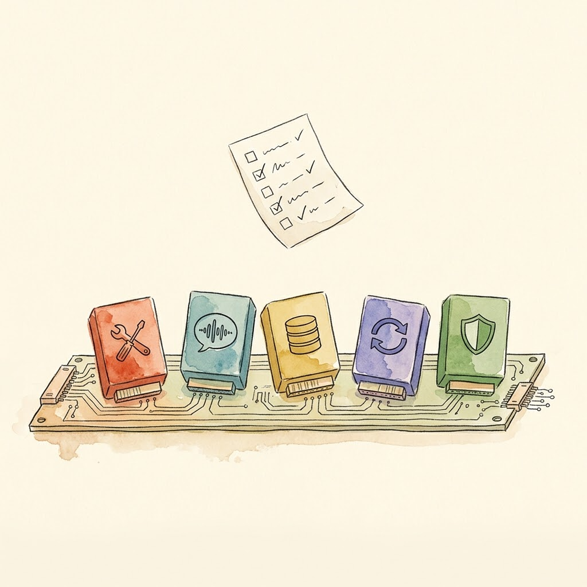
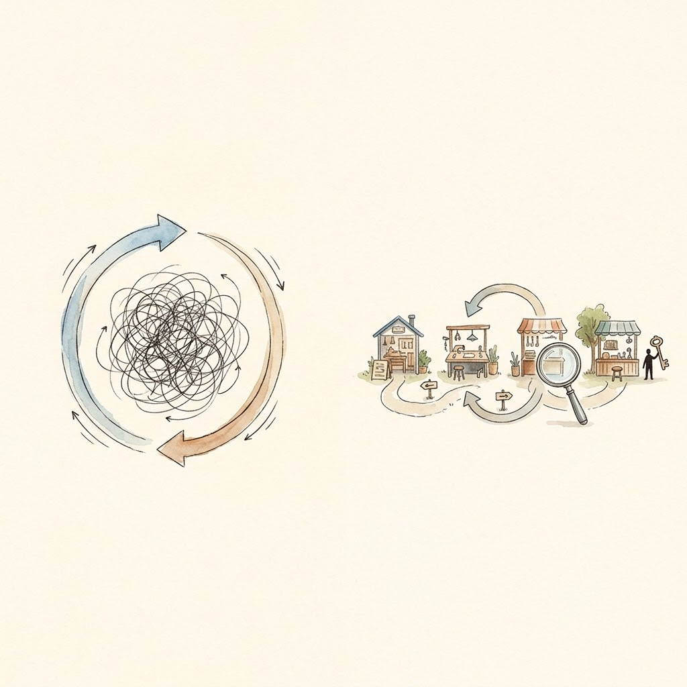

> 上一篇是 [Day 6｜给你的 Agent 装一个新工具](/posts/2026/10/ai-path-l3-day6-install-a-tool/)。单个工具装熟了，本篇回到骨干篇，回答 Day 6 结尾的问题：如果模型、会话、甚至别的 Agent 都能插件化，Harness 会变成什么样子。

本篇是 L3 的骨干篇。后续导航：

| Day | 类型 | 主题 |
|-----|------|------|
| Day 8 | 骨干 | 记忆、轨迹与可观测性 |
| Day 9 | 练习 | 毕业项目：搭建团队级 CI/CD 自动化 Harness |
| Day 10 | 阶段小结 | L3 毕业考核 + Harness 未来趋势 |

---

## 为什么需要元架构

先回忆一下你这一周用 Agent 的方式。

昨天你在让它改代码，用的工具是编辑器加终端；今天你想让它查数据库写周报，需要的是 SQL 查询和表格输出；明天你想让它监控一家竞品网站的更新，需要的是定时调度和通知。三个场景，三套工具，三种记忆策略，甚至三个合适的模型，但你的 Harness 只有一份。

Day 2 我们讲过 Pi 的答案：核心做薄，需要什么自己装。这个答案对一个人、一台机器很有效。但它有一个隐含前提：你愿意自己动手扩展。一旦你想把同一套工作流交给团队，想换模型时不动任何工具代码，想让一个 Agent 调用另一个 Agent，「自己写扩展」就不够了。

DeepSeek Harness 走了另一条路，也是本篇的主角：**元架构**。不写死任何一个部件，而是把「拼装 Harness 的能力」本身做成架构。它的官方架构文档第一段就是这句话：Cordis 框架之下，**产品的每一个部分都是插件：模型适配器是插件、工具注册表是插件、会话日志是插件、连 Agent Loop 本身也是插件**，每一个都可以从配置层替换[1]。

没有元架构的 Harness 像一体机：出厂什么规格就是什么规格，除了部分硬件可替换、可外接，要换显卡就得换整机。有元架构的 Harness 像台式机：每个部件插在标准插槽上，换任何一个都不动其他。Day 5 我们问「这个工具该落在哪一层」，今天这个问题变成：**如何把整个 Harness 的每一层，都变成插拔件？以及为什么？**

## Cordis 内核：一切皆插件怎么落地

「一切皆插件」听着像口号，Cordis 把它拆成了五条可以逐条检查的规则[2]：

1. **插件是一个实现 Service 接口的对象**。可以是一个函数，也可以是一个类，没有厚重的插件 SDK。
2. **上下文是服务的仓库**。每个服务占一个稳定的 `ctx.<key>`（`ctx.tools`、`ctx.llm`、`ctx.sessions`），其他插件按键找服务，而不是 import 一个具体实现。这是解耦的物理基础：调用方根本不知道实现方是谁。
3. **依赖用 `inject` 声明**。插件声明自己需要哪些服务，框架等依赖齐了再激活它。加载顺序由服务依赖关系决定，不用手写启动脚本。
4. **插件之间用类型化事件通信**。事件分五种派发模式（观察、包裹、并行、串行、首个否决），`tools/*` 这类瀑布事件就是 Day 3 讲的 Hook 的载体。
5. **注册是可逆的效果**。工具 schema、提示词段落、适配器、监听器，全部通过 `ctx.effect()` 注册，插件卸载时自动按逆序撤销，不留残渣。

第五条值得单独看一眼。传统架构里「卸载一个功能」是最没人想碰的操作：注册时撒了一地全局状态，卸的时候不知道漏了什么。Cordis 把注册和撤销绑定成一次效果（effect），插件卸载时按预期逆序撤销。一个功能能干净地卸掉，才敢放心地装——这是「一切皆插件」能从口号变成工程的前提。

落到用户侧是另一组概念：**profile 和 bundle**。profile 是一份有名号的组合单，声明这个 Harness 由哪些 bundle 堆叠而成；bundle 是 Cordis 配置行的分发单位，装进来自带代码和配置，而且上层永远可以继续 patch 它[1]。所有 profile 共享的第一层叫 `dsh-base`：模型适配器、工具、持久化、沙箱和审批策略、设置、凭证、遥测，全在这一层。往上有加浏览器应用的，有加无服务器一次性运行的，有给 SDK 用的。

「配置即组合」到这里就是字面意思。你想看自己机器上实际拼出来了什么，跑一条命令：

```sh
dsh --profile web --dump-config
```

打出来的每一行都是一个插件，任何一行都可以被你自己的 patch 替换[1]——这就是元架构的验收标准。



我自己的项目里没有 Cordis，但解决过同一类问题，只是那时没有标准插槽，结果写在 [Aristotle v1.6 的双语言架构](/posts/2026/07/aristotle-v16-cross-language-design/)里：Watchdog 用 TypeScript 写、Intervention 用 Python 写，中间用 subprocess 桥接。这不是审美选择，是五类约束逼出来的——同步拦截必须在宿主 tool call 路径上、1166 个 pytest 测试资产不能丢、零新增基础设施、400ms 启动延迟不能阻塞每次调用、MCP 的容错模型刚好覆盖跨语言失败。那次拼装是点对点的，每个接缝都要自己谈协议；元架构做的，是把这类约束下的拆分决策变成默认能力——部件一开始就插在标准插槽上。

## 架构解耦的三个层面

插件化之后，「解耦」从口号变成三个可以分别操作的层面[1]。

**第一层：模型适配。** `ctx.llm` 是适配器接缝，注册一个新模型就是往这个接缝上放一个插件。同一套工作流换模型，不动工具、不动会话、不动 Loop。Day 2 说过 Pi 的选择是「不内置权限、交给外部容器」，DSH 的选择是「沙箱和审批策略也是可插拔的 capability seam」：安全策略是配置，不是硬编码。

**第二层：preset 与 bundle。** 把一组插件打包成「人设」，就是 preset。标准模式、PTC 模式、极简模式、创造模式，你在界面上切换的模式，本质就是四份插件声明单。下一节细讲。

**第三层：sub-agent 组装。** `ctx.subagents` 一个接缝背后挂着六个官方后端：进程内 spawn、进程内 fork、ACP、Codex、Claude Code、另一个 DSH 实例[3]。调度 Claude Code 或 Codex 跑一个子任务，和调度本地子 Agent 走同一条接口。这就是「把第三方 Agent 当作插件嵌入」的正式形态：元架构的拼装范围不限于自己的部件，别人的整机也能插进来。

这个层面还有一个更激进的实验：Agent Teams。给根会话开启后，团队得到一个共享任务板：任务是有向无环图，`blockedBy` 边声明依赖，`writeScopes` 圈定每个任务的写路径（注意是 advisory 建议，不是锁），每次修改用 compare-and-set 的版本号防冲突[4]。成员之间走普通的 subagent 消息。

对 Agent Teams 我要多一句嘴：它最近刚从实验包毕业，代码从 `packages/experimental` 挪进了 `packages/team`，架构文档也摘掉了 Experimental 标签——但收敛过程的 churn 痕迹还在文档里：roster 花名册和 mailbox 邮箱已标成「历史格式」，身份、消息、发现全部移交普通 subagent 机制[4]。学它的设计原理（共享状态、任务 DAG、写范围）很有价值；把它建进生产系统之前，先想好任务板之外的概念会不会再变。插件市场也还在「Experimental plugins」开关底下藏着，默认不开[5]。

## 什么时候该从 loop 升级成 graph

元架构解决「部件怎么拼」，还没回答「拼出来的系统长什么形状」。walkinglabs 第 14 讲给了一个判断框架：单个 loop 撑不住时，系统会长成 graph[6]。

先把话说准：graph 不是新发明。节点、边、共享状态、路由规则这四要素，Airflow 和 Temporal 用了几十年；Anthropic 在《Building Effective Agents》里列的五种模式，绘制出来全是图[7]。真正的新东西只有一个：**节点的类型从「函数」放宽成了「Agent」**。工作流节点是确定性代码，图工程节点可以是一个带自己 loop 的完整 Agent，边也可以由上一个节点的产出动态决定。用 Anthropic 的判据一句话分清两者：控制流由代码固定，是 workflow；模型能在运行时改变步骤，是 agent[7]。

walkinglabs 总结了单个 loop 上规模之后的三种结构性失效[6]：三种失效都源于 loop 的结构本身，换一份实现照样复发。

1. **Goodhart 定律**：单一指标被使劲优化就会不再是指标。walkinglabs 举的典型案例：客服团队围绕「工单解决率」建了 loop，周报数字月月涨，几个月后续费数据出来，流失翻了一倍：bot 会关工单了，但并没有真正解决问题。
2. **向上失明**：loop 里的目标是圣旨，结构里没有任何一个位置能问「这个目标本身对不对」。恒温器不会问 68°F 合不合适，销售 loop 不会问配额合不合理。
3. **冲突**：多个各自健康的 loop 互相打架——响应速度的 loop 拖累严谨性的 loop，增长的 loop 拖累质量的 loop，而每个 loop 自己的指标都显示运行良好。

这三种失败有个共同点：检查者和被检查者共享同一个大脑、同一段上下文。loop 可以加 checkpoint、可以加停止条件，但 checkpoint 也住在同一个 Agent 里，它不会问自己「这个指标对吗」。graph 不加检查点，它**把检查挪到一个独立节点上**，给那段全新上下文[6]。这就是 Day 9 毕业项目要亲手搭的 maker-checker：verify 节点永远看不到 implement 节点的推理过程，只看到共享状态里的代码——「独立审核」在 graph 里是靠上下文隔离实现的，不是凭自觉。

loop 和 graph 的区别，Luis Catacora 有一句最狠的概括：「loop 有很大的容错空间；graph 逼你承认你的工作流里有多少东西其实从没被真正建模过。」[6] 翻成工程语言：**loop 是把决策推迟到出事那天，graph 是把决策提前画在纸上**。loop 把问题藏在 loop 里，graph 把问题写在纸上；前者适合探索，后者适合生产。



但使用 graph 也有代价。Addy Osmani 在《The Orchestration Tax》里算过这笔账：启动一个 Agent 只要一个回车，验收它的产出、和别的 Agent 的改动对账，都要有人，而那个人是你，而且只有一个你。他的原话：「你就是你的 AI Agent 们的 GIL。它们可以全部并行，但凡哪份工作需要真正理解架构、需要解决合并冲突，这份工作就必须抢到锁。锁只有一把，就握在你手里。」[8]

这种代价也压在工程上，不只压在人身上。我自己的项目里就有过一次：Aristotle 的 Watchdog-Intervention Bridge 否决过一个实时 HTTP 通信方案，理由是通信层本身的健康需要另一个 watchdog 来监控——每加一层编排，都要问一句谁来编排编排者[9]。最后的选法是把通信推迟到 checkpoint 批量处理：零违规时零额外开销，付出的是干预决策慢一轮。编排没有免费选项。

所以什么时候才值得升级为 graph？walkinglabs 给了五条标准，至少命中三条再动手[6]：

1. **任务能拆分成互不依赖的单元**，可以同时运行。例如三个模块的测试彼此独立，就可以并行执行。
2. **流程里有需要提前交代清楚的岔路**。比如测试失败之后该回到哪一步重做，做到一半发现信息不够又该退回哪一步补齐。这些回退路径应该提前写明，让每个协作方都看得见。
3. **运行到一半的状态值得存盘**。这样中断或崩溃之后可以从断点恢复，省去从头再执行的工夫。
4. **每个节点做完没做完，有机器能检查的标准**：例如测试通过、lint 不报错，不需要人来判断。
5. **省下的时间多于维护成本**：并行和回退带来的收益，必须大于维护图和共享状态投入的精力。

对照这份清单，「我的任务很复杂」排不上号：复杂只是事情多，不说明结构上有分工、验证、恢复的需要。五条一条都不命中就动手画图，得到的只是一张更贵的流程图。

## 四种模式：同一张插件树上的四种剪法

回到产品界面。DSH 内置的四个模式，官方文案把它们的边界写得很克制[10]：

| 模式 | 官方定义（转述） | 本质 |
|------|------------------|------|
| 标准模式 | 处理代码、文件和资料，适合大多数任务；按需使用检索、编辑、终端等工具 | 全量插件树 |
| PTC 模式 | 包含标准模式的全部能力，更适合批量调用工具、对结果筛选整理去重汇总的任务 | 工具调用写进代码 |
| 极简模式 | Agent 使用终端和图片读取工具，支持上下文压缩，适合测试和对比基础表现 | 减法体验 |
| 创造模式 | 用对话定制 DSH：让 Agent 编写插件、添加功能或界面，也能组合工具和提示词创建自己的模式 | Harness 改自己 |

三个非标准模式，各自值得多说一句。

**PTC（Programmatic Tool Calling）模式**回答的是 Day 5 埋过的问题：工具结果太多怎么办。它的做法是让 Agent 通过 `run_code` 写一段 TypeScript 程序，用生成的工具 SDK 发起调用：循环、条件、并发都在程序里，工具结果先交给程序筛选聚合，**模型只看到程序输出的成品**[10]。当前版本的 PTC preset 还刻意关掉了 workflow 和插件管理工具，把决策空间压到只做批量处理。这是「上下文经济是第一约束」的又一个官方注脚。PTC 最近还独立成了可选的 capability seam（`ctx.ptcRuntime`）：它在 Agent Loop 主干之外按需挂载，官方执行环境甚至放在沙箱 Node 里[11]。

**极简模式**值得你停下来想一下：DSH 这样的加法派产品，内部保留了一个接近 Pi 的剪法：几乎只剩终端，把 Harness 对模型的干扰降到最小。官方指南甚至直接建议你做一个实验：从同样的初始状态出发，同一个任务分别在标准模式和极简模式各执行一遍，对比完成度、工具调用次数和最终改动[10]。这个实验设计就是 Day 1 miniharness 精神的产品版：别信宣传，执行一遍看数据。

**创造模式**是元架构的化身：Agent 先查看再修改。两个只读检查工具 `cordis_inspect_list` 和 `cordis_inspect_query` 让它在写插件代码之前，先查询运行中的 Harness 加载了哪些模块、每个模块的确切方法签名[12]，然后对话式编写插件，经 Plugin Manager 持久化进 profile。这不是「让 Agent 写代码」那么简单，是**让 Agent 修改自己脚下的 Harness**——自我演化的入口开在元架构上，因为只有插件化的系统才允许被运行中的自己安全地改写。

## Pi vs DSH 的终局对比

走到这里，L3 的两大主角可以正面分一次胜负了。没有胜负。

- **Pi 相信**：一个足够薄的核 + 用户自己扩展。你要的是控制感，代价是凡事自己动手。
- **DSH 相信**：一个可组合的插件网络 + 社区生态。你要的是生态，代价是概念门槛和维护面。最新的证据：连 Claude Code 的插件格式（mods）都能挂进 Cordis 组合机制，官方理由只有一句——"mods join the one composition mechanism every DSH plugin uses"[13]。

这不是信仰之争，是约束画像之争。我在 [v1.6 架构复盘](/posts/2026/07/aristotle-v16-cross-language-design/)里写过一句话，拿来给这个对比收尾刚好：不存在脱离上下文的最优解——方案 A 好，方案 B 也好，在约束 X 下找出 A 和 B 哪个更不坏，才是设计要处理的问题。一个人在自己机器上追求极致响应速度和完全可见性，Pi 的约束画像胜；一个团队要换模型不动代码、要把审批策略交给配置，DSH 的约束画像胜。Day 2 和本篇合起来才是完整的判断题：**先减法，看清单核够不够你用；不够，再加法，看插件网络的代价你付不付得起**。

我自己的 GEAR 协议是一个现成的例子[14]：编排、生产、校验、消费、检索五个角色，分别落在 skill 文件、subagent 和 MCP 工具上。每个角色职责单一，交接走 git 里格式稳定的文件，替换任何一个角色都不动其他四个。所以在纠结选 Pi 还是选 DSH 之前，可以先做一件更基础的事：把系统设计成解耦的模块，模块之间只约定接口协议，内部实现不依赖具体技术栈，支持实例级的替换。

## 今日收获

1. **元架构的定义**：产品的每个部分——包括 Agent Loop 本身——都是插件，每个都能从配置替换。「可扩展」的验收标准是 `--dump-config` 能打印装配清单，任意一行换过。
2. **Cordis 五条规则**：Service 对象、ctx 按键寻址、inject 声明依赖、类型化事件、注册可逆。第五条（可逆）是前四条的地基。
3. **解耦三层面**：模型适配（`ctx.llm` 接缝）、preset/bundle（模式即组合单）、sub-agent 组装（别人的 Agent 也是插件）。Agent Teams 学原理，生产慎用。
4. **loop → graph 的判断**：三种结构性失败（Goodhart、向上失明、冲突）+ 五条标准（至少命中三条）。记住「你就是 Agent 们的 GIL」。
5. **四种模式是四种剪法**：标准求全、PTC 求批量、极简求基线、创造求自改。极简模式内置的「同任务双模式对照」实验，人人都能跑。

记住一句话：**判断 Harness 成熟度的标志只有一个：它的多少部分能被替换——包括它自己。**

Day 8 进入 L3 的最后一个阶段：系统拼好了，它跑得怎么样？记不记得事？崩了能不能接着跑？记忆、轨迹与可观测性。

---

## 深入学习资源

- [walkinglabs Lecture 14：图工程](https://github.com/walkinglabs/learn-harness-engineering/blob/main/docs/zh/lectures/lecture-14-graph-engineering/index.md)——loop 何时长成 graph 的完整框架，含可运行的 maker-checker graph 参考实现
- [LangGraph](https://github.com/langchain-ai/langgraph)——工业界图编排的代表实现，对照 DSH 的 preset 看取舍
- [Microsoft AutoGen](https://microsoft.github.io/autogen/)——多 Agent 编排的另一学派
- [A2A 协议](https://github.com/a2aproject/A2A)——跨组织 Agent 协作的协议化方向（L4 前瞻）
- [李博杰《深入理解 AI Agent》第 10 章](https://github.com/bojieli/ai-agent-book)——多 Agent 协作的理论框架

## 参考资料

1. [DSH 架构文档：Cordis、profiles/bundles、capability seams、subagent providers](https://github.com/deepseek-ai/deepseek-harness/blob/master/docs/architecture.md)
2. [DSH Cordis Primer：插件五条规则、事件派发模式、可逆注册](https://github.com/deepseek-ai/deepseek-harness/blob/master/docs/cordis-primer.md)
3. [DSH Subagent 子系统文档：`ctx.subagents` 接缝与六个官方后端](https://github.com/deepseek-ai/deepseek-harness/blob/master/docs/subsystems/subagent.md)
4. [DSH Agent Teams 子系统文档：共享任务 DAG、compare-and-set、历史 roster/mailbox](https://github.com/deepseek-ai/deepseek-harness/blob/master/docs/subsystems/agent-team.md)
5. [DSH 插件市场指南：Experimental plugins 开关与 plugin_market 工具](https://github.com/deepseek-ai/deepseek-harness/blob/master/docs/user/guide/plugin-market.md)
6. [walkinglabs Lecture 14：From Single Loops to Graph Engineering](https://github.com/walkinglabs/learn-harness-engineering/blob/main/docs/en/lectures/lecture-14-graph-engineering/index.md)
7. [Anthropic：Building effective agents（workflow 与 agent 的判据、五种模式）](https://www.anthropic.com/research/building-effective-agents)
8. [Addy Osmani：The Orchestration Tax（2026-05-16）](https://addyosmani.com/blog/orchestration-tax/)
9. [Aristotle v1.6 Watchdog-Intervention Bridge：实时拦截的设计与取舍](/posts/2026/06/aristotle-v16-watchdog-intervention-bridge/)
10. [DSH 内置 preset 官方文案与模式指南（agent-preset 组件 locales）](https://github.com/deepseek-ai/deepseek-harness/blob/master/packages/client/ui-agent-preset/src/client/guide-locales.ts)
11. [DSH PTC runtime 子系统文档：可选 capability seam 与沙箱 Node 决策](https://github.com/deepseek-ai/deepseek-harness/blob/master/docs/subsystems/ptc-runtime.md)
12. [DSH dsh-tool-cordis：Creator 模式只读检查工具](https://github.com/deepseek-ai/deepseek-harness/blob/master/packages/extensions/tool-cordis/README.md)
13. [DSH Claude Code mods 兼容桥文档：mods 接入 Cordis 组合机制](https://github.com/deepseek-ai/deepseek-harness/blob/master/docs/subsystems/claude-code-mods.md)
14. [七种人机协作模式：GEAR 五角色分解的完整标本](/posts/2026/04/seven-human-ai-collaboration-patterns-in-aristotle/)
